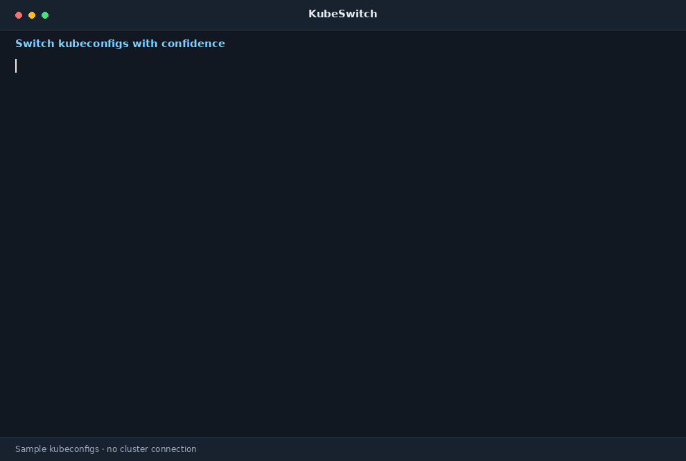

# KubeSwitch

Fast switcher between kubeconfigs, with a terminal background color per
config so prod is never mistaken for dev.



## Installation

On Linux and macOS (amd64 or arm64), one command installs the latest
release:

```sh
curl -fsSL https://raw.githubusercontent.com/Yanni8/kubeswitch/main/install.sh | sh
```

The [script](install.sh) picks the archive for your machine, verifies it
against the release's `checksums.txt`, and installs the binary to
`/usr/local/bin`, asking for `sudo` only if that directory is not
writable. Set `KUBESWITCH_INSTALL_DIR` to install somewhere else (for
example `~/.local/bin`) and `KUBESWITCH_VERSION` to pin a release:

```sh
curl -fsSL https://raw.githubusercontent.com/Yanni8/kubeswitch/main/install.sh \
  | KUBESWITCH_INSTALL_DIR=~/.local/bin KUBESWITCH_VERSION=v1.2.3 sh
```

Later, `kubeswitch update` brings the installed binary to the latest
release in one go (see below).

### Manual download

Every [release](https://github.com/Yanni8/kubeswitch/releases) ships
archives for Linux, macOS, and Windows on amd64 and arm64, named
`kubeswitch_<os>_<arch>.tar.gz` (`.zip` on Windows), plus `checksums.txt`.
The names never change, so the latest release is always at
`https://github.com/Yanni8/kubeswitch/releases/latest/download/<archive>`.

```sh
curl -LO https://github.com/Yanni8/kubeswitch/releases/latest/download/kubeswitch_linux_amd64.tar.gz
tar -xzf kubeswitch_linux_amd64.tar.gz kubeswitch
sudo install kubeswitch /usr/local/bin/
```

To verify a download, compare it against `checksums.txt` from the same
release (`sha256sum -c --ignore-missing checksums.txt`) or check its
signed build provenance with the GitHub CLI:

```sh
gh attestation verify kubeswitch_linux_amd64.tar.gz --owner Yanni8
```

Or build from source with `make install` (needs Go).

## Shell completion

`kubeswitch completion bash|zsh|fish|powershell` prints the completion
script for your shell; `kubeswitch completion zsh --help` (and so on)
explains where to put it. Besides commands and flags, it completes the
names of your kubeconfigs for `use`, `edit`, and `remove`, so
`kubeswitch use pay<Tab>` expands to `Payments Prod` (zsh and fish also
show each one's environment and color).

## Commands

### `kubeswitch add`

Adds a kubeconfig. It opens your editor (`$VISUAL`, then `$EDITOR`,
default `vim`) on an empty scratch file; paste the kubeconfig, save, and
quit. With `--file`/`-f` the kubeconfig is read from that file instead
and stored as is (if it refers to certificates by relative path, you are
warned, since the stored copy lives elsewhere; `import kubeconfig` makes
such paths absolute).
You are then asked for:

- a human-readable name (defaults to the kubeconfig's current context),
- whether it is a `prod` or a `dev` environment,
- a terminal background color (black, red, green, yellow, blue, magenta,
  cyan, white).

The name is a text field that shows the suggestion as a placeholder:
Enter accepts it, typing replaces it, and Tab (or `→`) copies it into
the field for editing. The other two are menus: move with `↑`/`↓` (or
`j`/`k`) and confirm with Enter. Esc or Ctrl-C aborts any prompt. When
stdin is not a terminal, the prompts turn into plain line-based ones
(`Name [suggestion]:` and numbered lists).

Kubeconfigs are stored with mode `0600` under `~/.config/kubeswitch/configs/`
(override the directory with `KUBESWITCH_CONFIG_DIR`), and the metadata in
`~/.config/kubeswitch/state.json`. Data from the tool's former name,
`~/.config/kswitch`, is moved there automatically on first use.

### `kubeswitch import aws [cluster]`

Imports the kubeconfig of an AWS EKS cluster instead of pasting one.
Without a cluster name, the clusters in the region are listed to pick
from. The kubeconfig is fetched with `aws eks update-kubeconfig`, so the
AWS CLI must be installed; `--region`, `--profile`, and `--role-arn` are
passed through to it. If no profile is configured (no `--profile`,
`AWS_PROFILE`, or `default` profile), you pick one of your configured
profiles from a menu, and if that profile has no region, you are asked
for one. You are then asked for the name
(defaulting to the cluster name), the environment, and the color, as
with `add`. Authentication to the cluster goes through the AWS CLI
(`aws eks get-token`); the profile, if given, is remembered in the
kubeconfig. `kubeswitch import` on its own lists the available providers.

### `kubeswitch import kubeconfig [file...]`

Imports the contexts of your existing kubeconfig: the files kubectl uses
(`$KUBECONFIG`, or `~/.kube/config`) unless files are given. Each
context is shown in turn with a Keep/Skip menu. A kept one becomes a
kubeconfig of its own, holding just that context with its cluster and
user, and you are asked for the name (defaulting to the context name),
the environment, and the color as with `add`. Files are merged the way
kubectl merges them, and relative certificate paths are made absolute so
the copies work from anywhere. Your original kubeconfig is not changed.

### `kubeswitch edit [name]`

Changes one thing about a kubeconfig. Without a name
you pick one from a menu, then choose what to change: the kubeconfig
contents (opened in your editor, pre-filled with the current file), the
name, the environment, or the color. The current value is suggested or
preselected, so Enter keeps it. Renaming keeps the stored file's name,
so shells already using it are unaffected.

### `kubeswitch list`

Lists the configured kubeconfigs with their environment and color
(alias: `ls`). Color swatches are shown only when printing to a terminal.

### `kubeswitch remove [name]`

Removes a kubeconfig and deletes its stored file (alias: `rm`). Without
a name you pick one from a menu. It asks for confirmation unless you pass
`-y`/`--yes`.

### `kubeswitch use [name]`

Switches to a kubeconfig (alias: `switch`). Without a name you pick one
from a menu. kubeswitch starts a new shell (`$SHELL`) with `KUBECONFIG`
pointing at the chosen config and the terminal background set to its
color; the text color is set to light or dark, whichever reads better on
it. Type `exit` to return to the previous shell, which restores both
colors. Inside the shell `KUBESWITCH_NAME` and `KUBESWITCH_ENV` are set, handy
for your prompt. The shell's exit status is passed through.

The colors are deep shades (red is `#5a1515`, for example) so that a
whole terminal in them stays comfortable and ANSI-colored output remains
readable; white is the one light option. The swatches in the menus show
sample text in the exact combination you will get.

### `kubeswitch update [version]`

Updates kubeswitch itself to the latest release, or to the given version
(`kubeswitch update v1.2.3`, also for downgrades). It downloads the archive
for this platform, verifies it against the release's `checksums.txt`,
and replaces the running binary in place. `--check` only reports whether
a newer release exists. If the binary's directory is not writable, run
`sudo kubeswitch update`. Not supported on Windows yet. `KUBESWITCH_UPDATE_URL`
points it at a mirror of the GitHub repository URL.

### `kubeswitch version`

Prints version information.

## License

kubeswitch is licensed under the [Apache License 2.0](LICENSE); the
copyright notice is in [NOTICE](NOTICE). `kubeswitch license` shows the
license together with those of the libraries it is built with, which are
collected under `internal/licenses/third_party` by `make licenses`.

## Releasing

Pushing a version tag publishes a release:

```sh
git tag v1.2.3
git push origin v1.2.3
```

The [release workflow](.github/workflows/release.yml) runs the tests,
cross-compiles the archives with `make dist`, signs build provenance
attestations for them, and publishes the GitHub release with generated
notes. Tags containing a `-` (such as `v1.3.0-rc1`) become pre-releases.

Releases are meant to be immutable. In the repository settings, scroll
to the **Releases** section and select **Enable release immutability**
(an organization can also enforce it for all or selected repositories
under Settings → Repository → General → Releases). It applies to
releases published after that: GitHub locks each one — assets can no
longer be added, replaced, or removed, the tag can no longer be moved or
deleted — and records a release attestation listing the tag, commit, and
assets. Only the title, notes, and the pre-release/latest flags stay
editable. The workflow is built for this: it creates the release as a
draft, attaches all assets, and publishes only once every upload has
succeeded, since assets cannot be attached after publishing.
